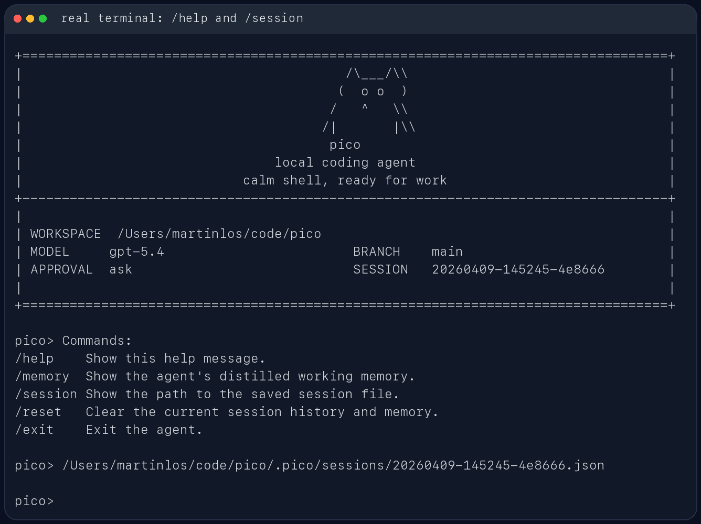

# pico

`pico` 是一个面向代码仓库的轻量本地 coding agent。它直接跑在终端里，先看当前工作区，再用一组受约束的工具去读文件、改文件、跑命令，并把会话状态保存在本地 `.pico/` 目录里。

它更像一个能在仓库里持续工作的命令行助手，不是纯聊天窗口。你可以拿它做代码排查、测试修复、仓库分析，或者让它在当前项目里执行一次性的工程任务。

## 适合做什么

- 在本地仓库里排查测试失败
- 读取当前代码结构并给出修改建议
- 基于现有文件做小步迭代，而不是脱离仓库空想
- 在会话中保留上下文，支持继续上一次工作

## 主要特性

- 包名是 `pico`
- CLI 命令是 `pico`
- 模块入口是 `python -m pico`
- 会话、运行、审批和事件保存在 `.pico/state.sqlite3`
- 每个工作区由独立 Host 管理后台任务，支持断线重连和跨终端审批
- 审计工件通过 `pico runs export <run_id>` 显式导出到 `.pico/exports/<run_id>/`
- 模型通过原生工具调用执行任务，支持一轮多个调用，按顺序校验、审批和执行
- 进度、工具状态与审批显示在 stderr，最终回答输出到 stdout；Ctrl+C 取消运行并保存现场
- 支持四类模型后端：
  - Ollama
  - OpenAI 兼容 Responses API
  - Anthropic 兼容 Messages API
  - DeepSeek Anthropic 兼容 API

## 使用截图

CLI 帮助信息：


启动界面：


REPL 内置命令与会话路径：



## 安装

需要 Python 3.10+。

如果你用 `uv`，直接安装依赖：

```bash
uv sync
```

如果你已经在自己的 Python 环境里工作，也可以直接装成可编辑模式：

```bash
pip install -e .
```

## 快速开始

在当前仓库里启动交互模式。默认 provider 是 DeepSeek：

```bash
uv run pico
```

指定另一个工作目录：

```bash
uv run pico --cwd /path/to/repo
```

直接跑一次性任务：

```bash
uv run pico run "inspect the test failures and propose a fix"
```

如果当前环境已经安装过包，也可以直接这样启动：

```bash
python -m pico
```

## 模型后端

Pico 启动时会读取项目根目录的 `.env`。本地真实 key 放在 `.env`，仓库只保留 `.env.example`。配置优先级是：

```text
显式 CLI 参数 > .env 里的 PICO_* 变量 > 旧环境变量 > 代码默认值
```

Provider 选择的具体顺序是：

```text
--provider > PICO_PROVIDER > 代码默认 deepseek
```

不传 `--provider` 且没有 `PICO_PROVIDER` 时默认使用 `deepseek`。这是推荐配置路径：DeepSeek 的 Anthropic-compatible endpoint 比本地 Ollama 更少依赖本机模型环境，也比 OpenAI-compatible/Anthropic-compatible 代理少一层默认 gateway 假设。其他 provider 仍然保留，可以在 `.env` 里写 `PICO_PROVIDER=openai`、`PICO_PROVIDER=anthropic`、`PICO_PROVIDER=ollama`，也可以显式传 `--provider openai`、`--provider anthropic` 或 `--provider ollama`。

`.env` 会在构建 provider client 前加载，并覆盖当前进程里的同名环境变量。模型名和 base URL 可以通过 `--model`、`--base-url` 临时覆盖；API key 只从环境变量读取。

本地第一次配置：

```bash
cp .env.example .env
```

然后把要使用的 provider key 填进去。`.env` 已经被 `.gitignore` 忽略，不要提交真实 key。

### 推荐配置：DeepSeek

最小配置只需要 key：

```bash
PICO_DEEPSEEK_API_KEY="your-api-key"
```

默认模型和接口是：

```bash
PICO_DEEPSEEK_API_BASE="https://api.deepseek.com/anthropic"
PICO_DEEPSEEK_MODEL="deepseek-v4-pro"
```

所以常规情况下 `.env` 里只填 `PICO_DEEPSEEK_API_KEY` 就能直接启动：

```bash
uv run pico
```

如果你需要临时切模型或代理地址，不必改 `.env`，可以直接覆盖：

```bash
uv run pico --model deepseek-v4-pro --base-url https://api.deepseek.com/anthropic
```

DeepSeek 当前走 Anthropic-compatible Messages API，所以 runtime 里复用的是 Anthropic-compatible client；这只影响 HTTP 协议，不影响 CLI 用法。

Pico 使用原生工具协议，并完整保存回放所需的 provider 响应块。DeepSeek 当前仍显式关闭 thinking，沿用有界的单步输出预算；这不影响原生工具调用。

### 后台任务、重连与取消

`pico` 默认进入交互会话，`pico run "任务"` 提交一次任务并显示进度。首次使用时自动启动当前工作区的本地 Host；同一工作区的任务串行执行。

```bash
uv run pico run "检查测试失败" --detach
uv run pico runs list
uv run pico runs attach <run_id>
uv run pico approvals list
uv run pico approvals approve <approval_id>
uv run pico approvals deny <approval_id>
uv run pico runs cancel <run_id>
uv run pico host status
uv run pico host stop
```

运行选项放在子命令之前，例如 `pico --session latest --max-steps 10 run "继续修复"`；显式选项覆盖会话默认配置。`--detach` 输出 run_id 后退出，任务继续执行。终端关闭或连接断开也不会取消任务；在 attach 时按 Ctrl+C 会向 Host 提交取消。进度和审批显示在 stderr，最终回答输出到 stdout。新 attach 默认回放已有事件，`--after <sequence>` 可以从指定游标继续。

ask 模式下的审批保存在数据库中，有效期为 30 分钟，可以从另一个终端回复。批准只对对应调用生效；审批期间工作区变化会使批准失效。等待审批会占用当前工作区执行槽，用户可以拒绝或取消来继续处理后续任务。

旧 `.pico/sessions/*.json` 不自动导入，也不再作为恢复入口；请创建新的数据库会话。使用 `--session <session_id>` 或 `--session latest` 继续当前原生协议的会话，切换 provider 协议需要新会话。

Host 异常退出后，原来未结束的运行标记为 interrupted，不自动重放工具。执行结果未知时需要先检查文件；未确认命令已结束的工作区会阻止新执行。`completed` 表示执行正常结束，任务正确性仍由测试或 verifier 判断。

当前验收平台为 macOS/POSIX。每个根 Run 使用独立 worker，命令监督进程在 worker 退出后清理 shell 进程组；两路输出各保留最多 64 KiB，默认命令超时 20 秒，最大 120 秒。模型可见工具文本另有 4000 字符展示限制。

开发者入口为 `ApplicationService` 和 `HostClient`，执行内核继续使用 `ModelRequest`、`ModelResponse`、`ToolExecutionResult`。模型所需原始回放块保存在私有会话中，展示事件先脱敏再公开。逐 Token 流式输出、Windows 进程管理和桌面审查面板留待后续阶段。

阶段计划和验收记录仅保存在本地 `docs/`，不纳入 GitHub 仓库。

### macOS 桌面预览

桌面端可选择/恢复最近工作区，创建会话、提交任务、查看工具活动、批准或拒绝操作并取消运行。CLI 与桌面操作同一个 Host/Run；关闭窗口和退出应用都只断连，后台任务继续，重开后从工作区数据库恢复。

新会话设置可选择 provider、模型及审批模式；已存在会话显示其冻结配置，改变原生协议时应新建会话。本次审批模式只影响新提交的任务。连接说明显示脱敏 endpoint 与密钥是否配置，密钥仍在项目 `.env`，桌面不提供密钥编辑。

发送前持久化请求 ID 和待确认请求，快速重复点击只有一个任务；回执丢失时重开应用可“重试确认同一次发送”，复用原 ID。明确拒绝受理的配置/阻塞错误允许修正后重新发送；传输结果未知时不会自动创建新任务。其他非终态任务存在时，新输入明确加入 Host 队列。审批提交后等待 Host 确认，取消也要等待真实终态；中断或结果未知会提示先检查工作区。

每个可见 Run 只有一条可中止的事件订阅，切换工作区、运行、重载或关闭窗口时断开；迟到响应按工作区/组件生命周期隔离。历史和工具卡片使用稳定身份去重、按需分页，模型输出作为纯文本显示。最近工作区/选择保存在 Electron userData 的小 JSON，待确认发送保存在该应用的本地存储；运行、审批和历史事实仍以 SQLite 为准。

桌面任务控制需要 Host API 4。支持 `idle_upgrade` 的 Host 可以“升级空闲 Host”，其空闲检查与停止接收任务之间没有异步间隙；有执行、排队或范围观察时拒绝升级。API 1–3 缺少这一原子保护，桌面只提示手动路径：先完成任务，再显式 `pico --cwd <workspace> host stop`，然后刷新连接；不会为了升级而停止活动任务。断连会显示状态并重连，blocked 和配置错误分别展示。

在 macOS Apple Silicon 上构建内部试用包：

```bash
uv run python -m scripts.prepare_desktop_runtime
cd desktop
nvm use
npm ci
npm run typecheck
npm test
npm run package
```

产物为 `desktop/out/Pico-darwin-arm64/Pico.app`，可用 Finder 打开。包内带有经过 SHA256 校验的 CPython；运行不依赖系统 Python、uv、项目虚拟环境或开发服务器。目标仓库使用的 Git、测试框架等开发工具仍需自行安装，模型配置仍读取该仓库的 `.env`。

首版仅支持 macOS arm64 的本地内部试用，尚未签名公证；桌面 Diff/验证审查面板在后续节点接入，当前可通过 CLI 查看。构建下载发生在打包阶段，Python 的来源与校验值见 `desktop/python-runtime.json`。运行 `npm run test:electron` 可验收真实打包窗口、CLI 交叉控制、回执丢失与退出恢复、跨工作区隔离及版本不兼容路径；模型请求使用本地原生 HTTP fixture，不等同于 live 效果验收。

### 运行差异与数据升级

新运行会在取得执行槽后保存工作树基线，并在结束时保存冻结的文件差异。基线包含运行开始时你已有的修改，比较不以 HEAD 为起点；审查过程不修改 Git index，也不执行 stash/reset。外部编辑与工具可能交错，因此差异表示运行期间观察到的变化。

`pico runs export <run_id>` 除执行记录外，还导出脱敏的 `review.json`、`changes.json`、`diffs.json` 和 `checks.json`。CLI 与桌面共用 Host 查询；桌面审查面板在后续节点接入。敏感文件、二进制、大文件、忽略项与采集失败都有明确范围/缺失提示，不能将没有 Diff 当作没有修改。

```bash
uv run pico runs review <run_id>
uv run pico runs changes <run_id> --scope run
uv run pico runs diff <run_id> --file-id <changes返回的id> --after 0
uv run pico runs checks <run_id> --limit 20
uv run pico runs tool_calls <run_id> --limit 20
uv run pico runs review_refresh <run_id>
uv run pico runs list --session-id <session_id> --limit 20
uv run pico sessions list --limit 20
uv run pico configuration
```

`run_shell` 可声明 `purpose: verification`，默认仍为 `general`，审批、预算与执行路径不变。检查只按真实退出码、超时、取消及中断事实归类；`echo ok` 成功只证明该命令成功，不代表测试覆盖。检查前后及 Run 结束时比较有界审查范围的内容指纹，后续修改使成功证据变为 `stale`，缺失/不完整证据为 `inconclusive`。历史结果保持冻结，`review_refresh` 只返回当前树的漂移观察，执行中返回 `busy`。此范围遵循前述忽略与大小限制，不声明验证整个仓库。

Host API v3 增加 `configuration.get`、`runs.tool_calls`、`runs.checks`、`runs.review_refresh`。列表显式传 `cursor: ""` 开始分页，返回 `items/next_cursor`，后续传回不透明游标；会话和 Run 按稳定创建顺序分页，不被后续更新或新记录打乱。Run 列表支持 `session_id`。工具/检查分页同样使用游标，单页限制 256 KiB、最多 100 条，检查输出每流显示最多 8192 字符并标记截断；完整的执行输出仍受原有 64 KiB/流限制。命令显示也有 8192 字符上限与截断标记，私有记录保留原始命令。旧客户端未传列表游标时仍取得原有列表形状；新 CLI 使用分页。配置查询只返回 provider/model/去掉凭据及查询参数的 endpoint/密钥是否已配置，不返回密钥或环境变量。

API v4 的 `sessions.get` 为展示视图：消息有稳定 `message_id/message_index`，reset 后换历史身份，不返回原生 replay blocks、工具大参数或私有结构化结果。内容先脱敏再按 16384 字符截断，历史页最多 256 KiB；完整私有记录仍在数据库，工具结构化详情用 `runs.tool_calls`。`configuration.get` 可按 session_id 查询对应会话。配置视图、公开 Session/Run 及报告里的 endpoint 均移除 URL 凭据和查询参数；真实执行仍使用私有冻结配置。新增 `host.stop_if_idle` 只供受控空闲升级，不提供通用桌面停止 Host/文件/命令桥。

首次使用新 Host 时，SQLite schema v1 会备份到 `.pico/backups/` 后事务升级到 v2；保留会话、审批、调用与事件。旧运行没有采集过的差异显示不可用，不从当前文件重建。旧 Host 不会被桌面自动强制重启；有活动任务时先完成或显式取消，再停止旧 Host，下一次连接启动新版。升级后的数据库供新版本使用，旧版本不能直接读取 v2。

首版每文件最多捕获 512 KiB UTF-8 文本、每 Run 内容合计 32 MiB、每工作区内容合计 256 MiB；超过限制仍可运行任务，但审查证据标为不完整，不自动删除历史内容。

### 可选配置：right.codes

right.codes 在 Pico 里有两条可选 provider 路径：

- `--provider openai`：走 OpenAI-compatible `/responses`，默认 base URL 是 `https://www.right.codes/codex/v1`，默认模型是 `gpt-5.4`
- `--provider anthropic`：走 Anthropic-compatible `/messages`，默认 base URL 是 `https://www.right.codes/claude/v1`，默认模型是 `claude-sonnet-4-6`

如果 right.codes 给你的是一把共享 key，推荐只填这一项：

```bash
PICO_RIGHT_CODES_API_KEY="your-right-codes-key"
```

然后按需要选择 provider：

```bash
uv run pico --provider openai
uv run pico --provider anthropic
```

如果你想显式区分两条 provider 的 key，也可以分别配置：

```bash
PICO_OPENAI_API_KEY="your-right-codes-key-for-codex"
PICO_ANTHROPIC_API_KEY="your-right-codes-key-for-claude"
```

不要在 `.env` 里写 `PICO_OPENAI_API_KEY=$PICO_RIGHT_CODES_API_KEY` 这种 shell 展开形式；Pico 的 `.env` 解析器只读取字面量，不展开变量引用。要么只写 `PICO_RIGHT_CODES_API_KEY`，要么把 key 字符串分别填到 provider-specific 变量里。

如果请求 right.codes 返回 `API Key额度不足`，说明协议和 endpoint 已经打通，但当前 key 没有可用额度；换一把有额度的 key，或到 right.codes 后台处理额度。

当前 provider 环境变量：

| provider | base URL | API key | model |
| --- | --- | --- | --- |
| `deepseek` | `PICO_DEEPSEEK_API_BASE`，回退 `DEEPSEEK_API_BASE`，默认 `https://api.deepseek.com/anthropic` | `PICO_DEEPSEEK_API_KEY`，回退 `DEEPSEEK_API_KEY` | `PICO_DEEPSEEK_MODEL`，回退 `DEEPSEEK_MODEL`，默认 `deepseek-v4-pro` |
| `openai` | `PICO_OPENAI_API_BASE`，回退 `OPENAI_API_BASE`，默认 `https://www.right.codes/codex/v1` | `PICO_OPENAI_API_KEY`，回退 `OPENAI_API_KEY`、`PICO_RIGHT_CODES_API_KEY`、`RIGHT_CODES_API_KEY`、`PICO_ANTHROPIC_API_KEY`、`ANTHROPIC_API_KEY` | `PICO_OPENAI_MODEL`，回退 `OPENAI_MODEL`，默认 `gpt-5.4` |
| `anthropic` | `PICO_ANTHROPIC_API_BASE`，回退 `ANTHROPIC_API_BASE`，默认 `https://www.right.codes/claude/v1` | `PICO_ANTHROPIC_API_KEY`，回退 `ANTHROPIC_API_KEY`、`PICO_RIGHT_CODES_API_KEY`、`RIGHT_CODES_API_KEY`、`PICO_OPENAI_API_KEY`、`OPENAI_API_KEY` | `PICO_ANTHROPIC_MODEL`，回退 `ANTHROPIC_MODEL`，默认 `claude-sonnet-4-6` |
| `ollama` | `--host`，默认 `http://127.0.0.1:11434` | 不需要 | `--model`，默认 `qwen3.5:4b` |

如果有额外的敏感环境变量需要从 trace/report 里脱敏，可以用 `PICO_SECRET_ENV_NAMES` 配置逗号分隔的变量名，或启动时重复传 `--secret-env-name NAME`。

### OpenAI 兼容接口

如果要改用 OpenAI-compatible `/responses` 服务，显式传 `--provider openai`：

```bash
uv run pico --provider openai
```

默认 OpenAI 兼容接口使用 right.codes 的 Codex endpoint：

```bash
PICO_OPENAI_API_BASE="https://www.right.codes/codex/v1"
PICO_RIGHT_CODES_API_KEY="your-right-codes-key"
PICO_OPENAI_MODEL="gpt-5.4"
```

也可以改成其他 OpenAI-compatible 服务：

```bash
PICO_OPENAI_API_BASE="https://your-api.example/v1"
PICO_OPENAI_API_KEY="your-api-key"
PICO_OPENAI_MODEL="gpt-5.4"
```

### Anthropic 兼容接口

如果要改用 Anthropic-compatible 服务，显式传 `--provider anthropic`：

```bash
uv run pico --provider anthropic
```

默认 Anthropic 兼容接口使用 right.codes 的 Claude endpoint：

```bash
PICO_ANTHROPIC_API_BASE="https://www.right.codes/claude/v1"
PICO_RIGHT_CODES_API_KEY="your-right-codes-key"
PICO_ANTHROPIC_MODEL="claude-sonnet-4-6"
```

如果你的服务端对多个兼容接口复用了同一套密钥，`pico` 也支持从 `PICO_ANTHROPIC_API_KEY` 回退到 `ANTHROPIC_API_KEY`、`PICO_RIGHT_CODES_API_KEY`、`RIGHT_CODES_API_KEY`、`PICO_OPENAI_API_KEY` 或 `OPENAI_API_KEY`。

### Ollama

如果要改用本地 Ollama，显式传 `--provider ollama`：

```bash
ollama serve
ollama pull qwen3.5:4b
uv run pico --provider ollama --model qwen3.5:4b
```

## 常用交互命令

- `/help`：查看内置命令
- `/memory`：查看提炼后的工作记忆
- `/session`：查看当前数据库会话 ID
- `/reset`：清空当前会话状态（有未结束任务时拒绝）
- `/exit` 或 `/quit`：退出 REPL

## 安全与持久化

`pico` 不会默认把所有动作都放开。像 shell 执行、文件写入这类高风险操作，会受审批模式控制：

- `--approval ask`
- `--approval auto`
- `--approval never`

运行状态、会话、工具结果、报告和事件以 SQLite 为唯一来源。完成状态与结束事件在同一事务提交；旧 JSON 文件不参与恢复。数据库和运行目录保存在本地，默认不上传仓库。

```bash
uv run pico runs export <run_id>
```

显式导出生成 `run_state.json`、`trace.jsonl`、完整的 `tool_results.json` 和已有的 `report.json`。导出失败会单独报告，不改变数据库中的执行结果。

Host 通过当前用户私有的 Unix socket 通信，不监听网络端口。凭据由环境或项目 `.env` 提供，不写入公共 RPC、运行配置快照或进程参数。Host 日志按大小轮转，worker 诊断有界保留。进程组管理不构成对同一用户恶意进程的沙箱。

## 开发

常用本地检查：

```bash
uv run python -m pytest tests -q
uv run ruff check pico tests scripts
```

内部代码现在按较轻的边界拆分：`pico/evaluation/` 放 benchmark 和 metrics，`pico/providers/` 放模型 provider client，`pico/features/` 放可选运行时能力。新代码应直接使用这些包路径；旧的 `pico.evaluator`、`pico.metrics`、`pico.models` 和 `pico.memory` import 不再作为公共入口保留。
